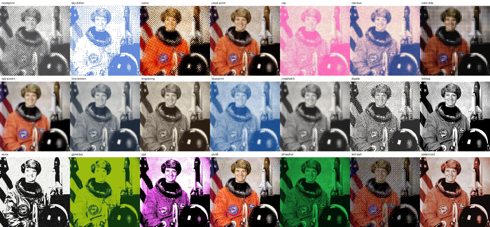
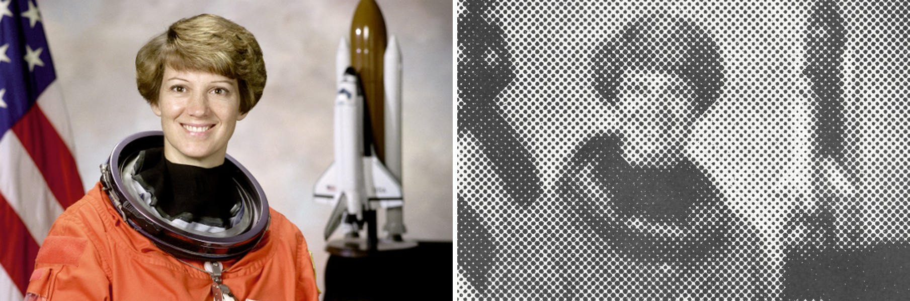
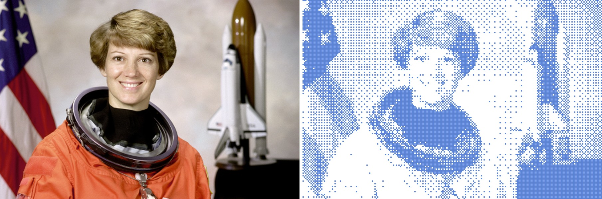
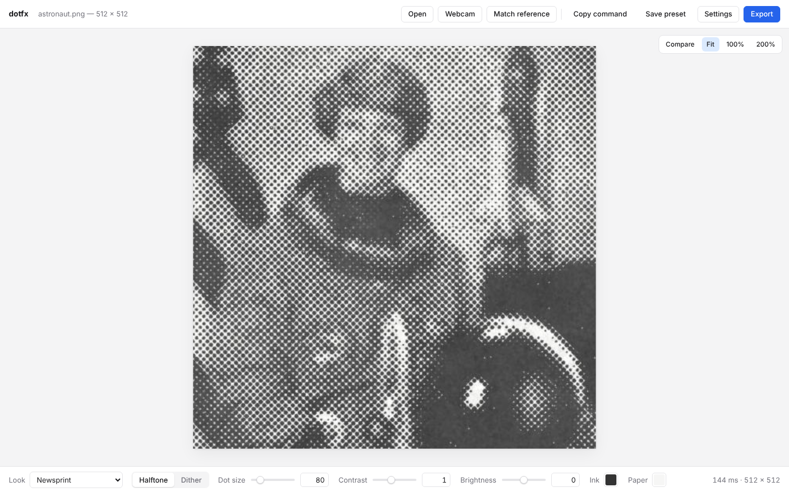
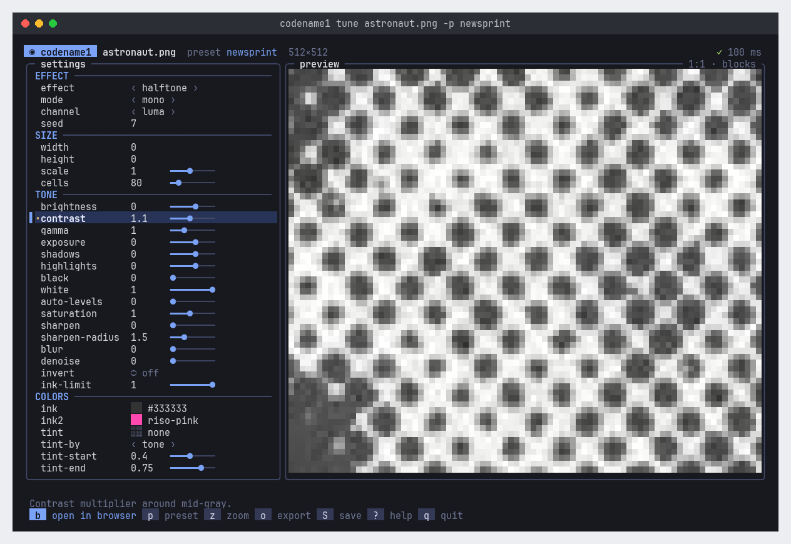

# dotfx

Turn photos and video into halftone and dither prints from the terminal.



dotfx has two engines:

- **halftone**: a rotated screen of dots whose size follows the image, as in offset
  printing. It has ten dot shapes, CMYK/RGB/duotone separations, and tone-accurate
  antialiased edges.
- **dither**: ordered (Bayer, clustered, blue noise, line) and error-diffusion
  (Floyd–Steinberg, Atkinson, Jarvis, Stucki, Burkes, Sierra…) dithering to
  ink/paper, gray levels, named palettes or colors picked from the image. Each
  dither pixel can be drawn as a square, circle, plus, ring and more.

Both engines share the same tone controls and print-texture layer: ragged dot
edges, ink bleed, uneven ink, paper grain, dust, scan softness, JPEG wear and a
paper-clipping edge. Video goes through ffmpeg, with audio kept and frames
rendered in parallel.

Around those engines:

- **`dotfx app`** is the same engine in a browser interface, running locally.
  Every terminal screen also has an **open in browser** button.
- **`dotfx match`** measures a reference print and writes a preset that recreates it.
- **`dotfx tune`** is a live terminal editor for every setting.
- **`dotfx live`** runs a webcam or video stream through a preset in the terminal.
- **SVG and PDF** output gives vector dots for print and plotters.
- **Masks** give the subject and the background different looks.

| `newsprint` | `sky-dither` |
|---|---|
|  |  |

## Install

Requires Python 3.11+, plus ffmpeg on your `PATH` for video.

```sh
pip install .            # numpy + Pillow
pip install '.[fast]'    # + numba: error-diffusion dithers ~80x faster
```

You can also run it without installing: `python -m dotfx ...`.

## Quick start

```sh
dotfx photo.jpg -p newsprint                 # → photo.newsprint.png
dotfx photo.jpg -p sky-dither -o out.png
dotfx clip.mp4 -p comic                      # → clip.comic.mp4 (audio kept)
dotfx clip.mov -p bitmap --width 480 -o loop.gif
dotfx shots/ -p riso -o printed/             # a whole folder
dotfx photo.jpg -p newsprint --preview-only  # just look, in the terminal
dotfx app photo.jpg                          # the browser interface
dotfx tune photo.jpg -p newsprint            # adjust interactively in the terminal
dotfx match reference.jpg                    # → reference.toml, a preset that recreates it
dotfx photo.jpg -p reference.toml            # … then use it on anything
dotfx photo.jpg -p newsprint -o poster.svg   # vector dots (also .pdf)
dotfx live                                   # webcam through a preset, in the terminal
dotfx gallery photo.jpg                      # every preset on one sheet
```

`render` is the default command, so `dotfx photo.jpg ...` is the same as
`dotfx render photo.jpg ...`. Running `dotfx` on its own shows a short overview
of the commands.

## Presets

`dotfx presets` lists them, and `dotfx presets NAME` prints one as TOML.

### Reference looks

Two families are matched to specific reference prints. Each reference was
measured for dot pitch, screen angle, ink and paper colors, and edge softness.
It was then descreened (blurred back to a continuous image), re-rendered with
the preset, and compared side by side. These presets size their dots with
`cells` (dots across the width), so they keep the reference's proportions at
any resolution.

| preset | look |
|---|---|
| `newsprint` | **the gray newspaper reference**: 45° round dots, 80 across. Dot gain makes small highlight dots print bold and then drop out. Mottled neutral-gray ink, grainy paper, light JPEG wear. Rendered from the descreened reference, its average tone lands within 0.1% of the original. |
| `newsprint-fine` | the same print with a finer screen (140 across) for more detail |
| `newsprint-coarse` | blown up to 45 big dots across, poster-like |
| `newsprint-clean` | the same screen without wear: crisp dots on white |
| `newsprint-clipping` | cut out like a clipping, with a soft shadow on white, as along the reference's top edge |
| `newsprint-faded` | an old yellowed clipping: washed-out ink, warm paper, heavy grain |
| `sky-dither` | **the blue sky reference**: 4×4 Bayer, 206 cells across. Dark blue round dots sit over a light-blue tint that fills only the blue sky; clouds get dots on white. The red channel drives tone, so the sky goes dark. Soft, JPEG-compressed finish (the compression also grays the small dots, as in the original). |
| `sky-dither-clean` | the same without blur or compression |
| `sky-dither-mono` | one blue ink, no tint |
| `sky-dither-bold` | chunkier: 110 cells across |

The sky presets place the tint by saturation, so on subjects other than sky
any colorful area gets tinted. Add `--tint-by tone` to tint the dark areas
instead.

### High-key black and white

Black ink on white where the paper dominates. They use `--ink-limit`, which
caps the darkest tone, so even black areas print as open dots and lines
(typically 75–95% white).

| preset | look |
|---|---|
| `bw-airy` | small round 45° dots |
| `bw-lines` | thin diagonal lines |
| `bw-stipple` | sparse blue-noise stippling |
| `bw-grid` | the sky-dither dot grid in black |

### Other presets

| preset | engine | look |
|---|---|---|
| `comic` | halftone | bold CMYK pop-art dots on warm paper |
| `cmyk-print` | halftone | fine process print with misregistration |
| `riso` | halftone | single fluorescent-pink risograph, uneven ink |
| `riso-duo` | halftone | two-color riso: blue shadows over a pink plate |
| `color-dots` | halftone | dots in the photo's own colors on black |
| `rgb-screen` | halftone | additive red/green/blue screens on black |
| `line-screen` | halftone | diagonal line screen, banknote style |
| `engraving` | halftone | wavy engraved lines in sepia |
| `blueprint` | halftone | pale dots on blueprint blue |
| `crosshatch` | halftone | cross dots that grow into a hatched grid |
| `stipple` | dither | blue-noise stippling with round dots |
| `bitmap` | dither | classic 1-bit Atkinson |
| `xerox` | dither | blown-out photocopy with toner noise and dust |
| `gameboy` | dither | four greens, ordered dither |
| `cga` | dither | cyan/magenta/white |
| `pico8` | dither | PICO-8 palette, Floyd–Steinberg |
| `phosphor` | dither | green-screen terminal glow |
| `led-wall` | dither | chunky RGB LED matrix |
| `posterized` | dither | 6 colors picked from the image, blue-noise dither |

Command-line options override a preset, and presets stack (`-p comic -p
my-tweaks.toml`). To save your own:

```sh
dotfx photo.jpg -p riso --ink riso-teal --cell 5 --save-preset teal.toml
dotfx other.jpg -p teal.toml
```

A preset file is flat TOML. `base` names a preset to start from:

```toml
base = "newsprint"
ink = "#1a2a6c"
cell = 7
roughness = 0.5
```

## Browser app



```sh
dotfx app                    # opens your browser
dotfx app photo.jpg -p riso  # start from a file and a preset
dotfx app --webcam
```

The browser app runs on your own machine and uses the same engine as the
command line. It has:

- **Preview:** full resolution, with zoom (scroll), pan (drag), 1:1 and 2×, and a
  draggable before/after split.
- **Looks:** every preset as a thumbnail rendered from your own image, or pick
  one from the menu in the bottom bar. ← → steps through them.
- **Settings:** every setting as sliders, switches, menus and color pickers,
  grouped and searchable. Values changed from the preset are marked.
- **Video:** a timeline to scrub through, and export to MP4, WebM or GIF with a
  progress bar.
- **Webcam:** a live, styled view, with snapshots at full camera resolution and
  recording to WebM. Expect about 10 fps at 560 px wide: each frame makes a
  round trip to Python.
- **Match a reference:** drop in an image of the look you want and it's applied.
- **Export:** PNG, JPEG, SVG and PDF at full resolution. Also *Save preset*
  (`.toml`) and *Copy command* (the equivalent command line).

The image takes up most of the window. The look and the most-used settings sit
in one bar underneath it; every look and every setting is in the **Settings**
panel (S). It follows your system's light or dark mode.

Large images preview at a reduced size to stay quick. Exports always use the
full size.

It only listens on `127.0.0.1`, and every request needs the random key in the
link it opens, so other web pages can't use it. `--port` picks a fixed port,
and `--no-open` just prints the link.

**From the terminal:** `tune` and `live` have an **open in browser** button
(click it, or press `b`). It opens the browser app with the same file, preset
and settings. After you quit the tuner, the browser app keeps running until
Ctrl-C. `live` hands the camera over to the browser.

## Recreate a reference: `dotfx match`

```sh
dotfx match reference.jpg --check check.png
dotfx photo.jpg -p reference.toml
```

`match` measures a halftone or dither image and writes a preset that
recreates it:

- **Pattern:** whether it's a halftone screen, an ordered (Bayer) dither or a
  blue-noise dither, plus the dot spacing and screen angle.
- **Colors:** ink, paper and any tint; separate per-color screen angles mean a
  CMYK or RGB print, and dots in many colors on black mean `color` mode.
- **Finish:** edge softness, paper grain, and the JPEG quality the image was
  saved at.

It then calibrates gamma, contrast and the tint range by re-printing a
blurred-back copy of the reference and comparing. `--check` saves that
comparison side by side. On the two references the bundled presets were built
from, it gets within about 2% average tone.

The preset sizes dots with `cells`, so it works at any resolution. Some things
it can't decide from the image alone, and it says so:

- whether a tint should follow tone or color (`--tint-by`)
- the JPEG quality of images that are pure black and white everywhere

A two-ink duotone is read as CMYK.

## Interactive tuner



```sh
dotfx tune photo.jpg -p newsprint
dotfx tune clip.mp4 -p comic          # videos: scrub with , . < >
```

The settings panel shows sliders, switches, choices and color swatches, and
marks every value you've changed from the preset with •. Rendering runs in the
background, so keys never wait.

In kitty, Ghostty, iTerm2 and WezTerm the preview is the real full-resolution
image (`g` toggles it). Other terminals get half-blocks; use `z` to zoom to 1:1
there to judge the dots.

Images larger than 1600px start at a reduced `scale` so the preview stays
responsive. The scale appears in the list like any other setting.

| key | action |
|---|---|
| ↑ ↓ / PgUp PgDn | select a setting (only those that apply to the current effect are shown) |
| ← → | adjust; `[` `]` or Shift+←/→ for ×10 |
| space | toggle a switch / next choice |
| enter | type a value (colors, palettes, angles…) |
| u | reset the setting to the preset's value |
| p / P | next / previous preset |
| z | zoom: fit, ¼, ½, 1:1, 2× |
| w a s d | pan while zoomed |
| , . / < > | video: step one frame / jump 5 s |
| g | sharp (graphics) or half-block preview |
| ? | key help |
| o | write the full-resolution image |
| S | save the settings as a preset TOML |
| c | show the equivalent command line |
| b | open the same file and settings in the browser app |
| mouse | click a setting to select it (click again to step it); click the key buttons; scroll |
| q / esc | quit and print the command line |

## Options

`dotfx options` lists every setting with its default, and `dotfx render -h`
shows the flags. Here they are by group.

**Effect**: `-e/--effect halftone|dither` and `-m/--mode`:

| mode | halftone | dither |
|---|---|---|
| `mono` | ink dots on paper | ink/paper (`--levels` for more shades) |
| `gray` | same as mono | `--levels` shades from ink to paper |
| `color` | dots carry the photo's colors | `--colors N` picked from the image |
| `cmyk` | four rotated process screens | — |
| `duotone` | `--ink` shadows plus an `--ink2` plate | — |
| `rgb` | additive R/G/B screens | per-channel `--levels` |
| `palette` | — | `--palette` (named, or `'#000 #f80 #fff'`) |

`--channel luma|red|green|blue|average|max|min` sets what drives tone in mono
and gray. `red` behaves like a red lens filter and turns blue skies dark.

**Size**: `--width`, `--height` and `--scale` resize before processing.
`--cell` (halftone) and `--pixel` (dither) are in output pixels, and fractions
such as `--pixel 3.5` work. `--cells N`
sizes dots relative to the image instead, with N dots across the width, so a
12-megapixel photo and a thumbnail get the same look.

**Tone**: `--brightness --contrast --gamma --exposure --shadows --highlights
--black --white --auto-levels --saturation --sharpen --sharpen-radius --blur
--denoise --invert --ink-limit`. `--ink-limit 0.35` means nothing prints darker
than about 35% ink, which keeps the result airy and paper-dominated.

**Colors**: `--ink --ink2 --paper` take names (`sky`, `riso-pink`, `blueprint`,
`phosphor`…), `#hex` or `r,g,b`. `--paper none` gives a transparent PNG.
`--palette` takes `gameboy cga pico8 c64 sepia riso vaporwave phosphor amber…`
or your own list. `--cmyk-inks` sets the four process inks.
`--tint COLOR` (mono/gray, both engines) prints a flat second color under the
ink, sharing its dot pattern. `--tint-by tone|saturation` with `--tint-start`
and `--tint-end` decides where it appears: darker areas, or colorful areas
like blue sky.

**Halftone**:

- `--cell`, `--angle`, `--spot euclid|dot|square|diamond|line|ellipse|cross|ring|wave|grid`
- `--angles "15 75 0 45"`: per-plate angles for CMYK/RGB
- `--softness`: edge antialiasing in pixels, 0 for hard aliased edges
- `--dot-gain`, `--min-dot`, `--max-dot`
- `--sample average|center`
- `--gcr`: black generation for CMYK
- `--misregister`: plate offset in pixels

**Dither**:

- `--algorithm`: `threshold random bayer2 bayer4 bayer8 bayer16 cluster4 cluster8
  bluenoise lines floyd-steinberg false-floyd-steinberg atkinson jarvis stucki
  burkes sierra sierra2 sierra-lite`
- `--pixel`, `--cell-shape square|circle|diamond|plus|x|hline|vline|ring|rounded`
- `--dot-size`: below 1 leaves gaps between cells
- `--size-by-tone`: dot size follows tone instead of color
- `--diffusion`: error strength
- `--serpentine`, `--spread`, `--bias`
- `--temporal`: steadies error diffusion in video (see below)

**Masks**: give part of the image this look and the rest something else.

- `--mask` takes an image (white = this look) or a built-in:
  - `bright`, `dark`: by brightness
  - `colorful`: e.g. a red jacket or blue sky
  - `center`
- `--background` decides the rest: a preset name or `.toml`, `original` (the
  photo itself), `paper`, or `none` (transparent).
- Fine-tune with `--mask-threshold`, `--mask-feather` and `--mask-invert`.

```sh
dotfx photo.jpg -p comic --mask colorful --background newsprint-clean
dotfx photo.jpg -p color-dots --mask center --background original
dotfx photo.jpg -p riso --mask subject.png --background paper
```

**Clipping**: `--clip-edge cut|torn|wavy` shows the print as a paper clipping
on a `--backdrop` color (or `none`), with `--clip-margin`, `--clip-rough` and
`--clip-shadow`. Torn edges show the lighter core of the paper.

**Texture**: `--roughness --rough-scale --ink-noise --ink-opacity --bleed --grain
--grain-scale --speckle --glow --vignette --post-blur --jpeg`. `--jpeg Q`
round-trips the print through a real JPEG encoder at quality Q, for the look of
an image that has been saved and shared a few times. For video, `--animate-grain`
re-rolls the texture every frame. Without it the paper stays still under the
moving image.

## Video

```sh
dotfx in.mp4 -p newsprint                         # h264, CRF 16, audio copied as AAC
dotfx in.mp4 -p comic --pix-fmt yuv444p           # no chroma subsampling: crisper colored dots
dotfx in.mp4 -p bitmap --start 12 --duration 4 -o clip.gif
dotfx in.mp4 -p riso -o out.webm                  # VP9 + Opus
dotfx in.mp4 -p riso --codec prores_ks -o out.mov # for editing
dotfx in.mp4 -p stipple -o frames/%05d.png        # image sequence
dotfx in.mp4 -p comic --compare                   # original | effect side by side
```

Halftones and ordered dithers stay put from frame to frame. Error diffusion
(Floyd–Steinberg, Atkinson…) is chaotic: a little sensor noise reroutes the error
and the whole pattern shimmers. For video, dotfx turns on `--temporal 1`. It
nudges each pixel's decision toward a fixed pattern, so static areas keep the
same dots, and it never changes the tone. On a noisy static shot it reduces the
cells that flip per frame like this:

| algorithm | without | with `--temporal 1` |
|---|---|---|
| Floyd–Steinberg | 29% | 6% (3% at `1.5`) |
| Atkinson | 20% | 0.6% |

Pass `--temporal 0` to keep the shimmer.

Other flags: `--fps`, `--max-frames`, `--crf`, `--encoder-preset`, `--no-audio`,
and `-j/--jobs` for the number of worker processes (default: all cores). Screen
geometry and static textures are cached between frames, so a 1080p halftone
takes about 0.5–1 s per frame per core.

## Live

```sh
dotfx live                       # first camera
dotfx live 1 -p comic            # another camera
dotfx live clip.mp4 -p riso      # a file (looped) or a stream URL
```

The screen lists every preset on the left. Move through it with ↑ ↓ and the
image restyles instantly. The other keys:

| key | action |
|---|---|
| `[` `]` | dot size |
| space | pause |
| `s` | snapshot (PNG; the preview frame flashes) |
| `r` | record (MP4; a blinking ● REC timer shows while recording) |
| `g` | switch between sharp and half-block preview |
| `b` | open the browser app with the webcam (it takes over the camera) |
| `q` | quit |

The key buttons and the preset list can also be clicked with the mouse.

Terminals without image support get a half-block preview, rendered straight at
the terminal's resolution so the dots show as blocks. If they'd be too small to
see, they're enlarged and the preview's title says so ("dots ×3"). Snapshots
and recordings always use the full camera resolution and the real dot size. Cameras are read through ffmpeg: v4l2 on Linux,
AVFoundation on macOS and DirectShow on Windows. `--capture-width` sets the
processing size. At the default 480 px, rendering takes 13–90 ms a frame here
(about 11–75 fps, from `bitmap` to `color-dots`), plus display time.

## Vector output (SVG / PDF)

```sh
dotfx photo.jpg -p newsprint -o poster.svg
dotfx photo.jpg -p comic -o print.pdf --dpi 300
```

Dots are written as real shapes. Each round dot is sized so that the inked area
inside its cell equals the tone, which stays exact where neighboring dots
overlap. Square, diamond, line and ellipse spots, and dither cells, are drawn
as their own shapes; other spots fall back to round dots. CMYK and duotone
plates overprint with multiply blending, like ink.

Raster-only effects (grain, roughness, blur, JPEG, clipping…) are left out,
and the tool lists which ones. `--dpi` sets the PDF page size from the image's
pixel size.

## Terminal preview

`--preview` (or `--preview-only`) draws the result in the terminal. In kitty,
Ghostty, iTerm2 and WezTerm the image is shown at full resolution through their
inline-image protocols. Other terminals get truecolor half-blocks. Use
`--preview-mode blocks|kitty|iterm` to choose.

The interactive tools (`tune`, `live`) work in any terminal with truecolor,
including Windows Terminal and Windows 10+ consoles.

## How it works

- **Halftone**: each pixel is placed in a cell of a rotated grid. The cell's
  tone is read from a cell-sized average of the image. Each dot shape is a spot
  function, and its values are remapped by rank so that the inked area at
  tone *t* is exactly *t*. This keeps tones accurate for every shape (tests
  hold this to within a few percent). Edges are antialiased from the spot
  gradient, so they stay crisp at any angle or cell size.
- **Dither**: the image is reduced to one value per dither pixel, quantized
  with a threshold map or error diffusion, and each pixel is drawn with an
  antialiased shape tile. Blue noise is generated once with void-and-cluster
  and cached in `~/.cache/dotfx`.
- **Match**: the reference's 2-D spectrum gives the dot lattice. In a halftone
  the screen's base frequency is the strongest peak. A Bayer dither instead
  puts its strongest energy in a 45° checkerboard, at frequency 1/(2 × cell),
  with weaker, tone-dependent patterns around it. JPEG quality comes from the
  quantization comb in each 8×8 block's DCT coefficients.
- **Texture**: roughness moves dot edges by a few pixels using value noise.
  Bleed spreads ink into nearby paper. Ink noise varies density across the
  page. Grain, speckle and post-blur are applied to the composite. Multi-ink
  modes overprint multiplicatively, like real inks.

## Development

```sh
pip install -e '.[test,fast]'
pytest
```
